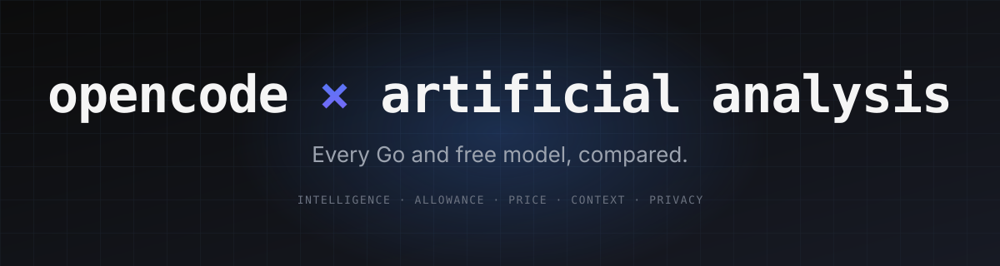
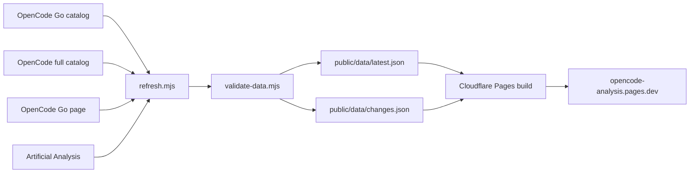
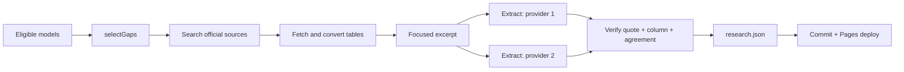

<div align="center">
  
</div>

<p align="center">
  <a href="https://opencode-analysis.pages.dev"></a>
  <a href="https://github.com/Valentjno/opencode-analysis/actions/workflows/ci.yml"></a>
  <a href="https://github.com/Valentjno/opencode-analysis/actions/workflows/research.yml"></a>
  <a href="LICENSE"></a>
  
  
</p>

<p align="center">
  <strong>English</strong>
</p>

# opencode analysis

An independent comparison of every model available through OpenCode Go and the
free tier, joined with [Artificial Analysis](https://artificialanalysis.ai/)
intelligence scores, published allowances, API prices, context windows, and
privacy terms. Built for developers deciding what to run this month.

It is not affiliated with OpenCode or Artificial Analysis. There are no paid
Console-only models, no server, no account, no cookies, and no analytics.

## What you get

| Page | What it does |
|------|--------------|
| Overview | Intelligence-per-cost hero, today's picks, snapshot stats |
| Models | Full searchable, filterable, sortable catalog |
| Analysis | AA-style workspace: intelligence, capability, benchmarks, openness, cost, performance, token use, context, size |
| Changes | Newest-first feed of additions, removals, price, allowance, and score changes |
| About | Methodology, rules, privacy tiers, limitations, credits |

## Design choices

- **Static first.** The site is a Vite + React build. All data is committed as JSON. There is no runtime API, database, or server. Cloudflare Pages rebuilds on every push.
- **Dual source.** OpenCode provides the catalog, access tiers, allowances, and privacy flags. Artificial Analysis provides the Intelligence Index, eval scores, capability scores, speed, and cost per task. The two are joined by a curated alias map.
- **Privacy is documented, not assumed.** Terms come from OpenCode's structured flags for Go models and a dated curated map for free models. Missing terms are labeled "Unknown" and never treated as private.
- **Deterministic recommendations.** Five picks are computed at refresh time with documented rules and deterministic tie-breaks. No model is ever presented as private when it trains on requests.
- **Pareto, not winners.** The value view shows non-dominated models. There is no single best model; the frontier is the answer.
- **Vendor colors.** Every chart colors points by vendor, so you can see who dominates a region. The frontier is shown as a ring, not a color, so the two encodings never clash.
- **Plan-centric value.** The principal view is what a $10 Go or $40 Go Plus plan buys: monthly allowance, request cap, and intelligence per dollar. API price is one of several cost axes, not the headline.
- **Verified external benchmarks.** A separate CI job fills benchmark gaps from official vendor sources. A value is shown only with an exact quote and agreement between two independent providers. External values never feed the Intelligence Index, the picks, or the Pareto frontier.

## Data flow



## Research pipeline



## Data sources

| Source | Used for | Mandatory |
|--------|----------|-----------|
| [`opencode.ai/inference/go/v1/models`](https://opencode.ai/inference/go/v1/models) | Go catalog | Yes |
| [`opencode.ai/inference/v1/models`](https://opencode.ai/inference/v1/models) | Full catalog, to discover free models | Yes |
| [`opencode.ai/console/go`](https://opencode.ai/console/go) | Published monthly and 5-hour allowances | No |
| [`artificialanalysis.ai`](https://artificialanalysis.ai/) | Intelligence Index, evals, capability scores, speed, cost per task | No |

Model data and allowances come from OpenCode. Benchmark data comes from Artificial
Analysis. Both are credited in the site footer and methodology page. Scores are
matched by published page slug, with a small curated alias map in
`data/aliases.json`; privacy terms for free models are curated in
`data/free-privacy.json` because the Go API does not carry those flags.

## Local development

```bash
npm install
npm run refresh     # regenerate data (network required)
npm run validate    # check the published JSON files
npm test            # 97 unit tests
npm run lint
npm run dev         # http://localhost:5173
npm run build
```

Node 24 or newer is required.

## Deployment

The repository is public under `Valentjno/opencode-analysis` and licensed under
the [MIT license](LICENSE). Cloudflare Pages is connected to the repository;
the project name is `opencode-analysis`, so the site is served at
`opencode-analysis.pages.dev`. The build command is `npm run build` and the
output directory is `dist`.

## Privacy note

Go models use OpenCode's structured `training` and `zdr` flags. Free models use
a curated, dated map built from the OpenCode privacy documentation. Models with
undocumented terms are labeled **Unknown** — never "private". The recommended
private option requires no training, zero retention, and an Intelligence Index
of at least 30; when nothing qualifies, the site says so instead of inventing a
pick. A model that trains on requests is never presented as equivalent to one
that does not.

## External benchmark research

A CI job can fill benchmark gaps for models that have no Artificial Analysis
Intelligence Index. It uses the [Free-LLM Router](https://free-llm.com/router)
as the only model gateway, verifies each value against an exact quote on an
official source, and publishes only verified values in a separate
`public/data/research.json` layer. External values never feed the headline
Intelligence Index, the recommendations, or the Pareto frontier.

See [docs/research-setup.md](docs/research-setup.md) for the protected GitHub
environment, the free provider keys, and the rotation policy. Model data and
allowances come from OpenCode; benchmark data comes from Artificial Analysis.
This project is independent and not endorsed by either. Source code and data are
published under the MIT license.

## Credits

Model data and allowances come from
[OpenCode](https://opencode.ai/). Intelligence Index, eval scores, capability
scores, speed, and cost-per-task come from
[Artificial Analysis](https://artificialanalysis.ai/). This project is an
independent, community-made view and is not endorsed by either.

## License

[MIT](LICENSE)
